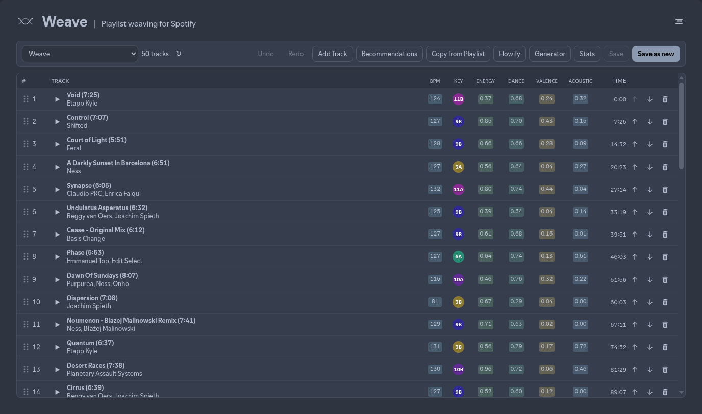

# <br /> Weave

Spicetify custom app for editing Spotify playlists in the desktop client — rearrange tracks, pull recommendations, search/add/copy tracks, Flowify auto-arrange, and generate new playlists. Inspired by [MixMoose](https://mixmoose.com).

Runs inside a logged-in Spotify desktop session with [Spicetify](https://spicetify.app/) installed.



## Features

- Load playlists, drag-reorder, undo/redo, save / save as new
- Feature columns + stats (energy, dance, valence, BPM, key, …)
- Recommendations from seeds / feature ranges (Song Radio + local filters)
- Add Track, Copy from Playlist
- Flowify (sets / curves) and Generator
- Session restore + durable UI prefs
- Keyboard shortcuts (`?` in the app)

## Install

See Spicetify’s [Custom Apps](https://spicetify.app/docs/customization/custom-apps) guide.

### Via Marketplace

Spicetify’s **Marketplace** (sidebar) can install some custom apps with one click. Weave is **not** listed there yet — use the manual steps below.

### Manual installation


#### 1. Copy into CustomApps


| Platform          | Path                              |
| ----------------- | --------------------------------- |
| **Windows**       | `%appdata%\spicetify\CustomApps\` |
| **Linux / macOS** | `~/.config/spicetify/CustomApps/` |


Put this app there as a folder named `weave`:

- If you cloned the full repo, copy or symlink the `app` directory:
  ```bash
  # Linux / macOS example
  ln -sfn /path/to/repo/app ~/.config/spicetify/CustomApps/weave
  ```
- Or copy only this folder’s contents into `CustomApps/weave/`.


#### 2. Enable and apply

```bash
spicetify config custom_apps weave
spicetify apply
```

`config custom_apps` **appends** to your existing apps; it does not replace them. To remove later:

```bash
spicetify config custom_apps weave-
spicetify apply
```

You can also edit `config-xpui.ini` and set `custom_apps` under `[AdditionalOptions]` (names separated by `|`), then run `spicetify apply`.

#### 3. Open Weave

Restart Spotify if needed, then open **Weave** from the sidebar.

If the icon is hard to find (e.g. Global Navbar layouts), open DevTools (`Ctrl+Shift+I`) and run:

```js
Spicetify.Platform.History.push("/weave")
```


### Troubleshooting

From the [Spicetify docs](https://spicetify.app/docs/customization/custom-apps):

1. Confirm the folder is under CustomApps and named `weave`
2. Confirm `manifest.json` is valid JSON
3. Run `spicetify apply` and restart Spotify
4. If the page is blank, check the console for errors and that `index.js` defines `render()`


## Keyboard shortcuts


| Shortcut               | Action                  |
| ---------------------- | ----------------------- |
| `Ctrl/⌘ Z`             | Undo                    |
| `Ctrl/⌘ Shift Z` / `Y` | Redo                    |
| `Ctrl/⌘ S`             | Save                    |
| `Ctrl/⌘ Shift S`       | Save as new             |
| `Ctrl/⌘ F`             | Recommendations         |
| `Ctrl/⌘ Shift A`       | Add Track               |
| `Ctrl/⌘ Shift C`       | Copy from Playlist      |
| `Ctrl/⌘ Shift F`       | Flowify                 |
| `Ctrl/⌘ Shift G`       | Generator               |
| `Ctrl/⌘ Shift T`       | Stats                   |
| `?`                    | Shortcuts help          |
| `Esc`                  | Close top panel / modal |


## License

[GNU Lesser General Public License v2.1](LICENSE) (same as [Spicetify](https://github.com/spicetify/cli/blob/main/LICENSE)).

Not affiliated with Spotify or MixMoose.