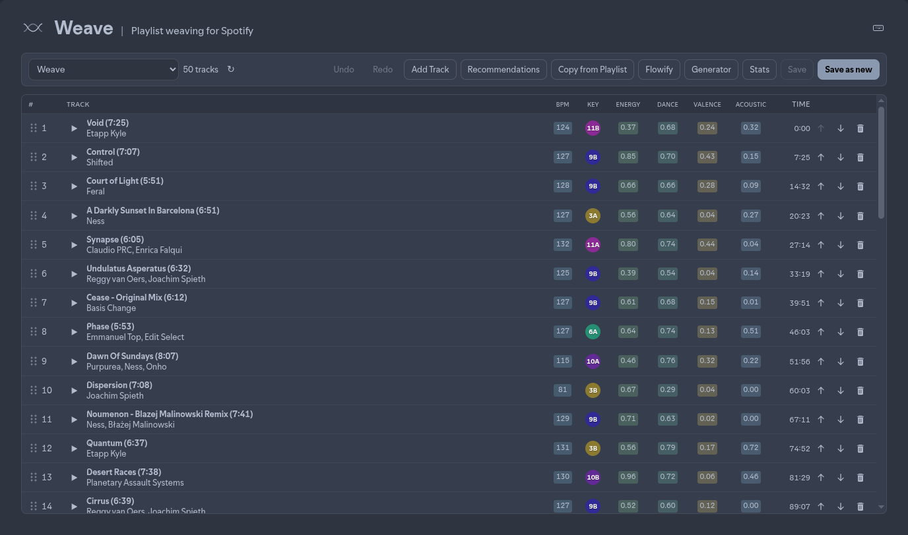

#   
 Weave

Spicetify custom app for editing Spotify playlists in the desktop client — rearrange tracks, pull recommendations, search/add/copy tracks, Flowify auto-arrange, and generate new playlists. Inspired by [MixMoose](https://mixmoose.com).

Runs inside a logged-in Spotify desktop session with [Spicetify](https://spicetify.app/) installed.



## Status (Creator Phase 4)

The live custom app mounts the **Weave editor** (TSX) from `src/app.tsx` — playlist load, arranger, search/Flowify/Generator entry points, and shared Header / PlayButton / FeatureCells. Legacy IIFE under `legacy/` remains the port baseline only ([spec](../docs/specs/Approved/creator-phase-4-ui-jsx.md)).

## Features

- Load playlists; add / remove / drag-reorder write through to Spotify; Flowify live-preview then Apply (one bulk write) or Save as new; Save as new from toolbar
- Arranger play prefers Spotify playlist context (Next continues the list); queue fallback if needed
- Feature columns + stats (energy, dance, valence, BPM, key, …)
- Recommendations from seeds / feature ranges (Song Radio + local filters)
- Add Track, Copy from Playlist
- Flowify (sets / curves, live preview table) and Generator
- Session restore + durable UI prefs
- Keyboard shortcuts (`?` in the app)


## How to use

Read the **[documentation](docs/README.md)** in the docs folder for more informations.

## Install

This folder is a **Spicetify Creator** project. Spicetify loads the **build output** in `dist/` (`nameId: weave`), not the TypeScript sources and not `legacy/`.

For day-to-day work in the full Weave repo, prefer the Nix/dev shell: see [DEV-SHELL.md](../docs/DEV-SHELL.md) (`weave-setup` / `weave-run` / `weave-watch`).

### Manual installation

See Spicetify’s [Custom Apps](https://spicetify.app/docs/customization/custom-apps) guide.

#### 1. Build

```bash
cd /path/to/repo/app
npm install
npm run build-local   # writes dist/
```

#### 2. Link CustomApps to `dist/`

| Platform          | Path                              |
| ----------------- | --------------------------------- |
| **Windows**       | `%appdata%\spicetify\CustomApps\` |
| **Linux / macOS** | `~/.config/spicetify/CustomApps/` |

```bash
# Linux / macOS example — link the build output, not app/ itself
ln -sfn /path/to/repo/app/dist ~/.config/spicetify/CustomApps/weave
```

#### 3. Enable and apply

```bash
spicetify config custom_apps weave
spicetify apply
```

`config custom_apps` **appends** to your existing apps; it does not replace them. To remove later:

```bash
spicetify config custom_apps weave-
spicetify apply
```

#### 4. Open Weave

Restart Spotify if needed, then open **Weave** from the sidebar.

If the icon is hard to find (e.g. Global Navbar layouts), open DevTools (`Ctrl+Shift+I`) and run:

```js
Spicetify.Platform.History.push("/weave")
```

### Troubleshooting

1. Confirm `CustomApps/weave` points at **`app/dist`** (contains `index.js`, `manifest.json`, `style.css`)
2. Re-run `npm run build-local` after source changes (or use `npm run watch` / `weave-watch`)
3. Confirm `manifest.json` in `dist/` is valid JSON
4. Run `spicetify apply` and restart Spotify
5. If the page is blank, check the console for errors and that the bundle exposes `render()`


## Keyboard shortcuts


| Shortcut               | Action                  |
| ---------------------- | ----------------------- |
| `Ctrl/⌘ Z`             | Undo                    |
| `Ctrl/⌘ Shift Z` / `Y` | Redo                    |
| `Ctrl/⌘ S`             | Save                    |
| `Ctrl/⌘ Shift S`       | Save as new             |
| `Ctrl/⌘ F`             | Recommendations         |
| `Ctrl/⌘ Shift A`       | Add Track               |
| `Ctrl/⌘ Shift C`       | Copy from Playlist      |
| `Ctrl/⌘ Shift F`       | Flowify                 |
| `Ctrl/⌘ Shift G`       | Generator               |
| `Ctrl/⌘ Shift T`       | Stats                   |
| `?`                    | Shortcuts help          |
| `Esc`                  | Close top panel / modal |


## Support

If Weave helps your playlists, you can [buy me a coffee](https://www.buymeacoffee.com/mdrees).


## License

[GNU Lesser General Public License v2.1](LICENSE) (same as [Spicetify](https://github.com/spicetify/cli/blob/main/LICENSE)).

Not affiliated with Spotify or MixMoose.
