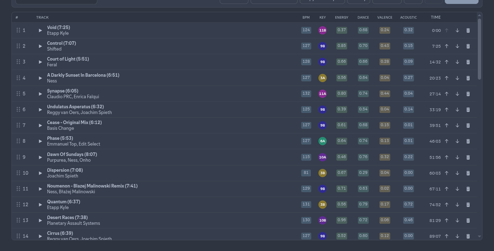
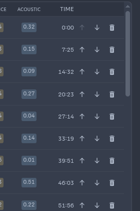

# Arranging tracks

Reorder and edit the loaded playlist in the track table.

## Columns

Typical columns (you can show/hide more):

| Column | Meaning |
| ------ | ------- |
| `#` | Position (with drag handle) |
| Track | Title, duration, artist; play/pause |
| BPM | Tempo |
| Key | Camelot-style key badge |
| Energy / Dance / Valence / Acoustic / … | Audio features (0–1 or unit as labeled) |
| Time | Cumulative start time in the set |
| Row actions | Move up, move down, remove |

### Show or hide columns

1. **Right-click** the table header (or use the Columns control where available).
2. Toggle columns on or off.
3. Visibility is remembered for next sessions.

### Sort

Click a column header to sort by that feature (e.g. BPM, Energy). Sorting changes **display** order in the editor only; it does not rewrite Spotify order by itself.

## Reorder

### Drag and drop

1. Grab the **six-dot handle** on the left of a row.
2. Drag to the new position.
3. Drop — the list updates and Spotify order updates **immediately** (no Save) when you can edit the playlist.

### Move up / down

Use the **↑** / **↓** buttons on the right of a row, or select a row and use `Alt`+`↑`/`↓` (see [Keyboard shortcuts](keyboard-shortcuts.md)). Same write-through as drag-drop.

### Remove

Click the trash icon on a row (or Delete with a row selected) to remove that track. The change is written to Spotify **immediately** (no Save).

## Playback

Click the **play** icon on a track to play it in Spotify. Weave queues the **open list from that row onward** (playlist context via the desktop queue API) so Next continues in order — same behavior as before the autosave playback rewrite.

Just-added rows disable play until the add write finishes and a real Spotify item uid is attached. Click again (or the pause affordance) on the playing row to pause.

## Tips

- After Flowify or large imports, the list may briefly flash and scroll to new rows.
- **Flowify** live-previews a new order in the modal; **Apply** writes once (bulk). Closing without Apply leaves Spotify unchanged ([Flowify](flowify.md)).

**Related:** [Seeds](seeds.md) · [Save and history](save-and-history.md)
