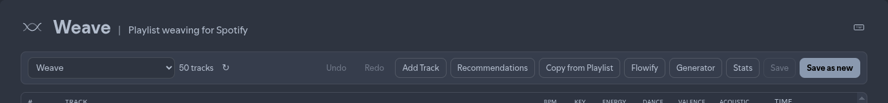

# Keyboard shortcuts

Press **`?`** in Weave (when not typing in a field) to open the in-app shortcuts help.

Shortcuts are ignored while the focus is in an input, textarea, or select (**except** Save / Save as new with modifiers).

## Editing

| Shortcut | Action |
| -------- | ------ |
| `Ctrl/⌘ Z` | Undo |
| `Ctrl/⌘ Shift Z` / `Ctrl/⌘ Y` | Redo |
| `Ctrl/⌘ S` | Save playlist |
| `Ctrl/⌘ Shift S` | Save as new |

## Panels and modals

| Shortcut | Action |
| -------- | ------ |
| `Ctrl/⌘ F` | Toggle Recommendations |
| `Ctrl/⌘ Shift A` | Add Track |
| `Ctrl/⌘ Shift C` | Copy from Playlist |
| `Ctrl/⌘ Shift F` | Flowify |
| `Ctrl/⌘ Shift G` | Generator |
| `Ctrl/⌘ Shift T` | Toggle Stats |
| `?` | Show this help |
| `Esc` | Close the top panel or modal |

## Arranger (click the track list first)

| Shortcut | Action |
| -------- | ------ |
| `↑` / `↓` | Select track |
| `Alt` + `↑` / `↓` | Move selected track |
| `Home` / `End` | First / last track |
| `Delete` | Remove selected track |
