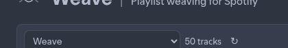

# Playlist picker

Load which playlist Weave edits.

## What you see

| Control | Role |
| ------- | ---- |
| Dropdown | Lists playlists from your Spotify library |
| Track count | Number of tracks currently loaded (e.g. `50 tracks`) |
| Refresh | Reloads the playlist list **and** re-checks the open playlist against Spotify |

## How to use

1. Open the dropdown and choose a playlist.
2. Weave fetches tracks and audio features into the table.
3. If a playlist is missing or outdated, click **Refresh**.

## Sync with Spotify

When you open Weave again, return focus to it, or click **Refresh**, Weave compares the open playlist to Spotify (track membership and order).

| Situation | What happens |
| --------- | ------------ |
| Same as last known Spotify order | Nothing |
| Spotify order/membership changed | Reloads from Spotify (toast: *Playlist updated from Spotify*) — no conflict dialog |
| Playlist deleted / unavailable | Error notify; playlist cleared from the picker when appropriate |

Remounting Weave restores the last **selected playlist URI** and **refetches** tracks. It does not restore a local-only draft order.

## Notes

- The empty state says *Select a playlist to edit its track order* until you pick one.
- Switching playlists loads that list from Spotify.
- Deleted or private playlists may show an error message — refresh and pick another.

**Next:** [Arranging tracks](arranging-tracks.md)
