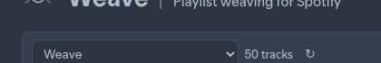

# Playlist picker

Load which playlist Weave edits.

## What you see

| Control | Role |
| ------- | ---- |
| Dropdown | Lists playlists from your Spotify library |
| Track count | Number of tracks currently loaded (e.g. `50 tracks`) |
| Refresh | Reloads the playlist list from Spotify |

## How to use

1. Open the dropdown and choose a playlist.
2. Weave fetches tracks and audio features into the table.
3. If a playlist is missing or outdated, click **Refresh**, then select it again.

## Notes

- The empty state says *Select a playlist to edit its track order* until you pick one.
- Switching playlists loads that list; unsaved edits on the previous list are not written to Spotify until you Save / Save as new.
- Deleted or private playlists may show an error message — refresh and pick another.

**Next:** [Arranging tracks](arranging-tracks.md)
