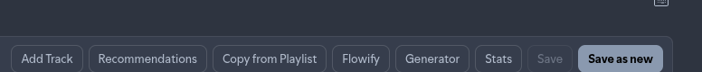

# Save as new and live edits

Weave is a **live view** of the open Spotify playlist. Add, remove, and single-row reorder write through to Spotify immediately. **Flowify** is preview-first: live-arrange locally, then **Apply to playlist** (one bulk write) or **Save as new** from the preview. There is no Unsaved badge and no overwrite Save.

## Live edits (no Save)

| Action | Spotify |
|--------|---------|
| Add track (search / copy / recommendations) | Immediate |
| Remove row | Immediate |
| Drag / ↑↓ / Alt+↑↓ reorder | Immediate (when you can edit the playlist) |
| Flowify **live preview** | Unchanged (local only) |
| Flowify **Apply to playlist** | One bulk write to the open playlist |
| Flowify **Save as new** | New playlist created; Weave loads the new playlist |

Failed writes revert the row/order in Weave and show an error notify. Flowify keeps the modal open until Apply / Save as new finishes so a second commit cannot race.

## Save as new

- **Toolbar / shortcut** (`Ctrl/⌘ Shift S`) — create a **new** playlist with the current track list (does not overwrite the open playlist), then open the new playlist.
- **Flowify** — create from the **preview** order, then open the new playlist; the original playlist on Spotify is unchanged.
- Works even when you cannot overwrite the source playlist (e.g. someone else’s list you rearranged for a copy).
- Default naming often appends `(Weave)` to the source name.

Overwrite Save (`Ctrl/⌘ S`) is removed.

## Undo / redo

Playlist undo/redo is removed. Closing Flowify without Apply discards the preview. After Apply, reverse changes in Weave or in Spotify’s native UI.

## Tips

- Prefer Flowify live preview carefully before Apply — Apply writes to Spotify once.
- Session restore remembers which playlist was open and refetches tracks from Spotify (it does not restore a divergent draft order).
- If Spotify changes the playlist while Weave is open, Weave reloads on focus/refresh and notifies you — no conflict dialog.

**Related:** [Arranging tracks](arranging-tracks.md) · [Playlist picker](playlist-picker.md) · [Flowify](flowify.md)
